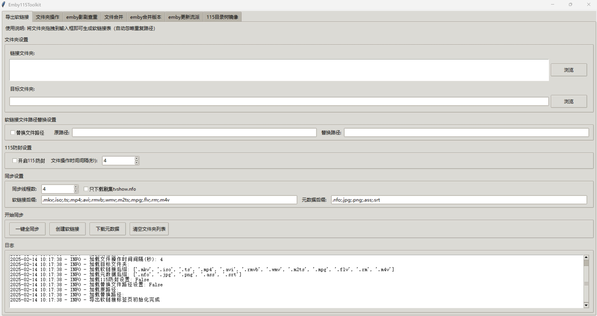
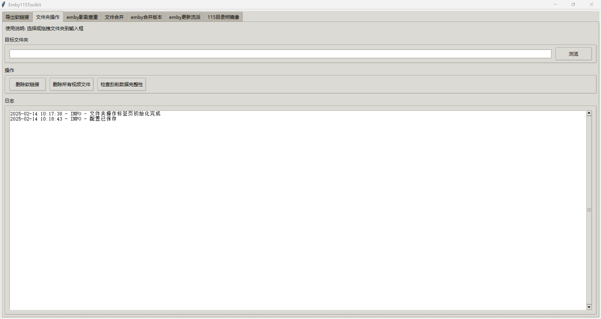
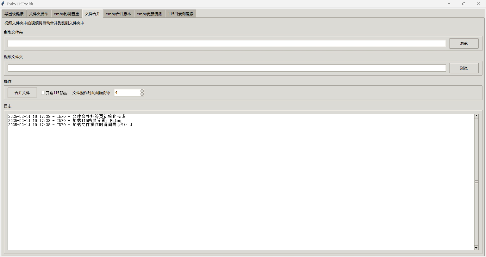
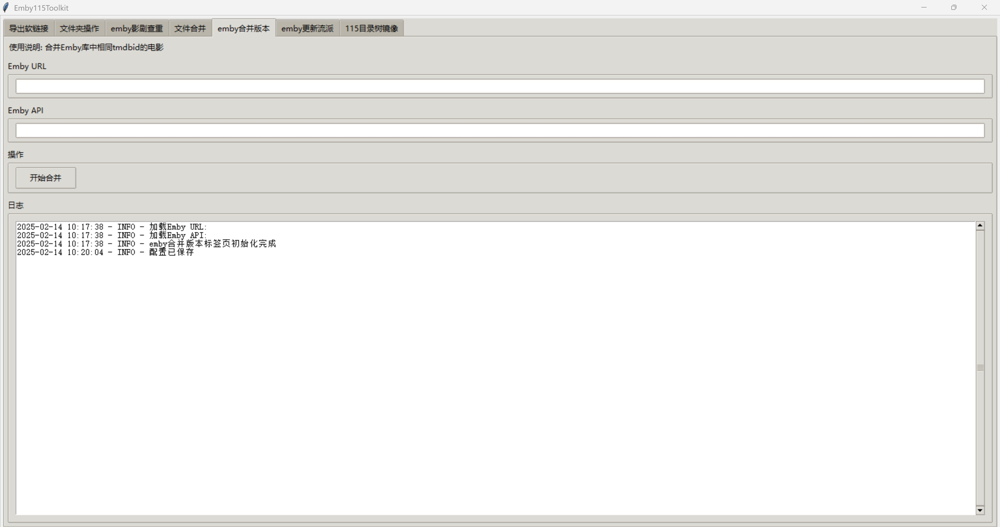
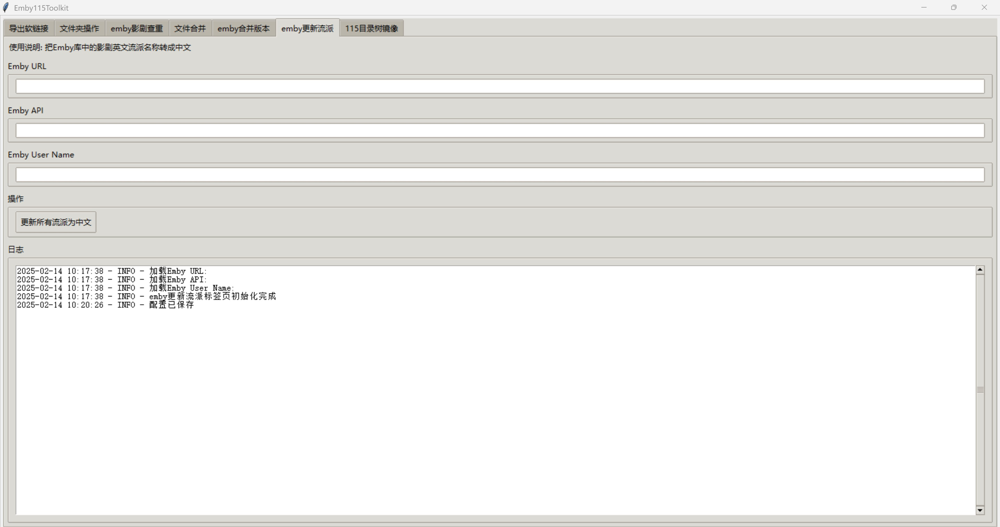
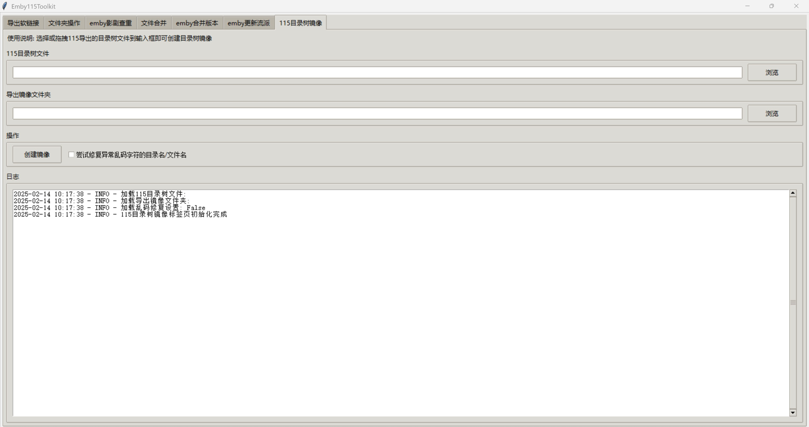

# Emby115Toolkit

面向 **115 网盘 + CloudDrive2 + Emby / Jellyfin** 的 Python 桌面工具，用于生成软链接、整理本地媒体文件和元数据，以及维护媒体服务器中的影片版本、流派和制作地区。

Windows 使用 tkinter 界面，macOS 使用 PyQt5 界面，两端共用业务逻辑和配置格式。**Linux 不受支持。**

交流与技术讨论：[Telegram 群组](https://t.me/embyfans)

## 当前项目状态

- 两个平台均提供七个功能页：导出软链接、文件夹操作、文件合并、合并版本、更新流派、更新地区、115目录树镜像。
- “服务配置”统一管理多个 Emby / Jellyfin 实例，三个媒体管理页面共用当前选择，重启后恢复。
- Jellyfin 已针对 **10.11.11 和 12.0** 的 API 契约实现兼容，自动识别服务器版本，无需手动选择版本。
- 流派和地区更新每次完整扫描所选用户可见的对应媒体库，仅保存需要修改的条目；已移除增量模式和扫描时间基线。
- 影片版本先按 TMDB ID 合并，再按规范化的 AV 番号跨来源合并，并跳过已合并的历史组及本轮已处理条目。
- 多源目录导出时保留各源文件夹名称；macOS 的源目录输入支持每行一个路径、粘贴、拖拽和逐个添加。

## 安装与启动

需要 Python 3 和对应平台的桌面环境。CloudDrive2 挂载路径用于访问云盘文件；仅使用媒体服务器管理功能时，填写服务器连接信息即可。

下载代码或克隆仓库：

```shell
git clone https://github.com/orut34iop/Emby115Toolkit.git
cd Emby115Toolkit
```

建议使用虚拟环境，避免依赖影响其他 Python 项目。`requirements.txt` 会按操作系统安装对应的 GUI 依赖。

### Windows

在 PowerShell 中运行：

```powershell
py -m venv .venv
.\.venv\Scripts\python.exe -m pip install -r requirements.txt
.\.venv\Scripts\python.exe windows_main.py
```

创建软链接和“一键全同步”会检查管理员权限，必要时请求提权并重新启动程序。请允许权限请求，再继续操作。

### macOS

```shell
python3 -m venv .venv
.venv/bin/python -m pip install -r requirements.txt
.venv/bin/python macos_main.py
```

macOS 使用 PyQt5，支持原生文件夹拖拽；创建软链接通常无需管理员权限，但需要目标目录的写入权限。请使用 `macos_main.py`，Windows 入口无法在 macOS 上运行。

## 功能说明

以下截图为历史界面示意，实际布局和选项以当前程序为准。

### 1. 导出软链接

- 从一个或多个源文件夹批量创建软链接，按后缀筛选视频文件。
- “下载元数据”将匹配的 NFO、图片和字幕等文件复制到目标目录；“一键全同步”依次复制元数据、创建软链接。
- 支持自定义链接后缀、元数据后缀，以及“只下载剧集 tvshow.nfo”。
- 支持路径替换：扫描本地镜像文件，将链接指向 CloudDrive2 的实际挂载路径。
- 单源导出保留源目录内的相对结构；多源导出在目标下增加各源文件夹名称，例如 `导出目录/电影/…`、`导出目录/剧集/…`。
- 显示扫描、创建进度和结果统计，支持停止任务。已移除“开启115防封”和额外创建间隔设置。

共享后端还包含 STRM 创建能力；当前两个 GUI 的导出页面提供软链接操作。



### 2. 文件夹操作

- 删除指定目录中的软链接。
- 删除指定目录中的视频文件。
- 检查刮削数据完整性，包括视频是否有对应 NFO、NFO 是否有对应视频。

“删除所有视频文件”会删除所选目录中的匹配视频文件，操作前请核对目录。



### 3. 文件合并

扫描“元数据文件夹”和“视频文件夹”，将与视频**同名（不含扩展名）**的元数据文件移动到视频所在目录；目标文件已存在时跳过。

例如：

```text
合并前：
元数据目录/fly (2025)/fly.2025.2160.dv.nfo
视频目录/fly.2025.2160.dv.mkv

合并后：
视频目录/fly.2025.2160.dv.mkv
视频目录/fly.2025.2160.dv.nfo
```

这是移动操作，成功后对应元数据文件会离开原目录。带有 `-poster` 等额外后缀的图片不满足与视频同名的条件。



### 4. 媒体服务配置

所有功能页都可通过“服务配置”入口管理媒体服务：

1. 点击“新增服务配置”，填写名称、可选分组、服务类型（Emby / Jellyfin）、完整服务地址、API Key 和用户名。
2. 保存后点击“使用此配置”，或在媒体管理页面的“当前媒体服务”下拉框中切换。
3. 在“合并版本”“更新流派”“更新地区”中执行相应操作。

同一台机器上的不同服务、端口或反向代理路径可分别保存。若使用反向代理，服务地址应包含基础路径，例如 `https://media.example/jellyfin`。

三个媒体页面共享当前服务；切换服务不改变其他页面的本地文件夹路径。媒体任务运行期间，服务切换和配置管理会锁定；停止任务后需等待工作线程结束。不同媒体任务按顺序执行。

### 5. 合并版本

- 支持 Emby 和 Jellyfin 的电影多版本合并。
- 先按相同 TMDB ID 分组，再按规范化 AV 番号跨来源分组。
- 番号来源包括 `num`、`javbus`、`javdb`、`javlibrary`、`dmm`、`mgstage`、`cid`；需要媒体条目已有对应的 Provider ID。
- 跳过已合并的历史组，避免本轮重复提交已处理条目。



### 6. 更新流派与地区

- **更新流派**：将电影和剧集的英文流派转换为中文，包含常见别名及部分 AV 流派映射。
- **更新地区**：将电影和剧集的制作地区名称或代码转换为中文，包含 `CN`、`UK` 等代码，以及黎巴嫩、突尼斯等地区映射。
- 每次完整扫描所选用户可见的对应媒体库，仅对需要修改的条目读取完整详情并保存。
- 加载配置时清理旧的 `scan_mode`、`sync_state`，保留媒体服务连接、配置 ID、当前选择和其他设置。

Jellyfin 使用 `Authorization: MediaBrowser Token="…"` 认证；条目查询采用分页和显式递归，保存前读取完整详情以保留其他元数据字段。10.11.11 / 12.0 的验证包括官方 OpenAPI 快照和本地 HTTP 测试替身，**不等同于两套实际服务器的完整联调**。详见 [Jellyfin 兼容范围和验证说明](docs/jellyfin-compatibility.md)。

本机 Jellyfin 12 提供自动加速：服务器身份、本机数据目录、用户权限及媒体库范围全部校验通过后，使用只读数据库快照扫描影片、剧集和隐藏版本，合并版本只对可见代表分组。身份、版本关系或结构无法确认时回退 API；未映射的虚拟媒体库单独通过 API 查询。远程服务器、10.11 和受限用户继续使用 API。

流派与地区更新最多同时处理 4 个候选条目，复用 HTTP 连接；每次保存前重新获取完整详情，保留其他字段和既有字段锁，保存后确认已提交的值及字段锁。本机可使用只读查询完成确认，所有实际修改仍经过 Jellyfin API。日志持续显示成功、无需变更、失败数量及处理速度；停止后不再安排新条目，等待已发出的请求收尾。

历史数据补锁另提供明确范围的命令行预览／执行流程，支持已合并副版本、备份、冲突检查和失败恢复：[中文说明](docs/metadata-protection.zh-CN.md) · [English](docs/metadata-protection.md)。日常中文化也会展开已合并副版本，分别保留并处理成员值。



### 7. 115 目录树镜像

读取从 115 官方导出的目录树文件，在本地生成相同层级的目录和空文件，供后续创建软链接或刮削工具使用；支持可选乱码修复。

镜像中的文件是占位空文件，不包含视频内容。



## 使用目录树镜像生成软链接

此流程通过扫描本地空文件树减少对云盘挂载目录的遍历，适用于大量文件。实际耗时取决于文件数量、磁盘和系统环境。

1. 使用 115 浏览器导出目录树。
2. 在“115目录树镜像”中选择目录树文件和本地导出位置，生成镜像。
3. 在“导出软链接”中选择本地镜像作为源目录，并选择软链接输出目录。
4. 勾选“替换文件路径”，将镜像路径替换为实际云盘挂载路径。
5. 点击“创建软链接”，完成后确保挂载可用，并检查链接指向。

Windows 示例：

| 设置 | 示例 |
| --- | --- |
| 链接源文件夹（本地镜像） | `C:\mirror\movie` |
| 目标文件夹（软链接输出） | `C:\media\movie` |
| 原路径 | `C:\mirror\movie` |
| 替换路径（实际挂载） | `D:\115\video\movie` |

镜像中的 `C:\mirror\movie\film.mkv` 会生成软链接 `C:\media\movie\film.mkv`，指向 `D:\115\video\movie\film.mkv`。

创建软链接不要求目标视频当时可读；若系统对挂载路径的探测影响速度，可在创建期间暂时卸载挂载，完成后重新挂载。复制真实元数据时需要源文件可读。

## 配置与日志

- 源码运行时，配置保存在项目根目录的 `config.yaml`；打包运行时保存在可执行文件所在目录。
- 首次加载旧媒体服务配置时，会创建 `config.yaml.pre-media-profiles-*.bak`，再迁移为独立服务档案；连接信息相同的旧配置会合并。
- 配置写入使用加锁和原子替换。配置及迁移备份可能包含 API Key，请勿提交或公开分享。
- 运行日志位于 `logs/`；macOS 另有 `logs/qt_runtime.log`，用于排查 Qt 启动、退出和未捕获异常。

## 项目结构与开发验证

```text
Emby115Toolkit/
├── windows_main.py          # Windows tkinter 入口
├── macos_main.py            # macOS PyQt5 入口
├── windows_gui/             # Windows 界面
├── macos_gui/               # macOS 界面
├── services/                # 文件、软链接、元数据、目录树等共享逻辑
├── media_server/            # Emby / Jellyfin API、流派和地区映射
├── utils/                   # YAML 配置、服务档案、日志等工具
├── tests/                   # 单元、集成、GUI 工作流及 API 契约测试
├── docs/                    # 专项说明
├── requirements.txt         # 运行与打包依赖
└── requirements-dev.txt     # 运行依赖及 Ruff
```

在已安装运行依赖的虚拟环境中，安装测试和开发工具并运行：

```shell
python -m pip install -r requirements-dev.txt pytest
python -m pytest
```

常用验证命令：

```shell
python -m pytest -m unit
python -m pytest -m integration
python -m pytest -m "not slow"
python -m pytest tests/unit/services/test_symlink_creator.py
```

上述 `python` 指已激活虚拟环境中的解释器；未激活时，可使用安装步骤中的完整解释器路径。

测试包括本地文件流程、配置迁移、服务档案管理、媒体 API 回归及 macOS Qt 工作流。Windows 原生 tkinter 工作流在 Windows 上执行，仓库已配置 [Windows 测试工作流](.github/workflows/windows-media-profiles.yml)。修改 GUI 后还应在对应平台启动入口验证实际界面。

Windows 打包脚本为 `windows_build.bat`，使用 `windows_build.spec`；另有包含旧机器绝对路径的 `windows_emby_toolkit.spec`，使用前需调整路径。仓库当前没有 macOS 专用打包配置。

## 致谢

项目使用了 [shenxianmq/MediaHelper](https://github.com/shenxianmq/MediaHelper) 的部分代码，感谢原作者。
